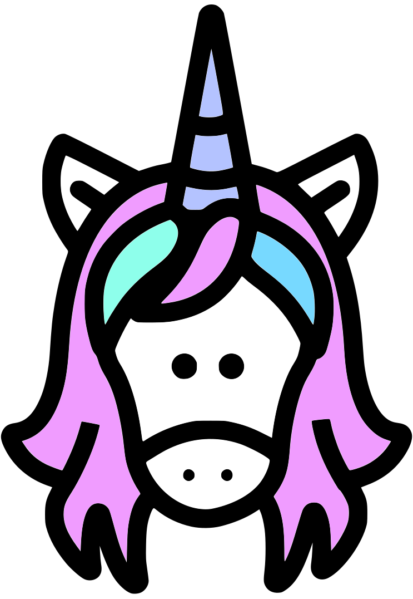
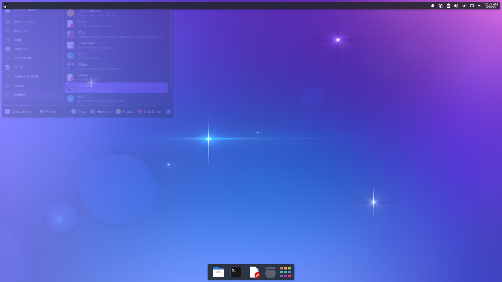
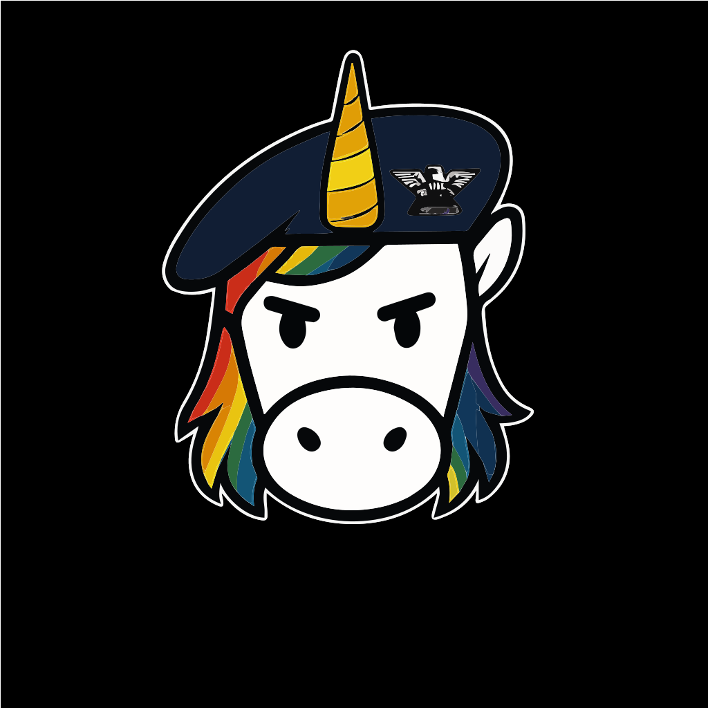

# Unicorn Commander UC-1 Website

<div align="center">



**Developed by Magic Unicorn Unconventional Technology & Stuff Inc.**

</div>

---

## 🦄 About

Welcome to the official website for **Unicorn Commander UC-1** - your command center for AI. Built for creators, entrepreneurs, and renegades who want to own their tools, customize their workflows, and crush cloud dependence.

<div align="center">



*UC-1 Desktop Environment - Customized KDE Plasma Interface*

</div>

## 🤖 Meet The Colonel

<div align="center">



*The Colonel - UC-1 Commander Agent*

</div>

The Colonel is your AI commander agent, part of our growing squad of unicorn agents designed to help you take command of your AI workflows with military precision and unicorn magic.

## 🚀 What is UC-1?

Unicorn Commander UC-1 is a modular, fully local AI powerhouse that combines:

- **Local LLM inference** with GPU acceleration
- **Lightning-fast vector search** & reranking
- **Embedded agents** with memory and task autonomy
- **Seamless support** for image generation, research, speech-to-text, and more
- **Modular services** you own, not rent

### Key Features

- 🔒 **Privacy First**: Your data stays with you, always
- 🧩 **Modular Design**: Upgrade hardware, swap software stacks, deploy custom AI agents
- 🌐 **Open Source**: Built on open standards and community-powered
- ⚡ **One-Click Setup**: Instant deployment, no PhD required
- 🔍 **Advanced Search**: Deep search capabilities with powerful indexing
- 🛠️ **Local Tools**: Run custom tools and function servers locally

## 🛠️ Tech Stack

- **Frontend**: React 18 with Vite
- **Styling**: CSS3 with Tailwind CSS
- **Animations**: Framer Motion
- **Icons**: React Icons
- **Routing**: React Router DOM
- **Deployment**: Docker with Nginx

## 🚢 Quick Start

### Prerequisites

- Node.js 18 or higher
- Docker and Docker Compose (for production deployment)

### Development

```bash
# Clone the repository
git clone https://github.com/SkyBehind/website-uc-1.git
cd website-uc-1

# Install dependencies
npm install

# Start development server
npm run dev
```

The development server will start on `http://localhost:7878` with full CORS support and hot reloading.

### Production Deployment

#### Using Docker (Recommended)

```bash
# Deploy with default settings (port 7878)
./deploy.sh

# Deploy on custom port
./deploy.sh --port 8080

# Clean deployment (removes old images)
./deploy.sh --clean --port 9000
```

#### Manual Build

```bash
# Build for production
npm run build

# Preview production build
npm run preview
```

## 🐳 Docker Configuration

The project includes a complete Docker setup with:

- **Multi-stage build** for optimized production images
- **Nginx configuration** for SPA routing
- **Health checks** for container monitoring
- **Flexible port configuration**
- **Production optimizations** with asset caching

### Docker Commands

```bash
# Build and start containers
docker compose up --build -d

# Stop containers
docker compose down

# View logs
docker compose logs

# Check container status
docker compose ps
```

## 📁 Project Structure

```
website-uc-1/
├── public/                 # Static assets
│   └── images/            # Product images
├── src/
│   ├── components/        # React components
│   ├── pages/            # Page components
│   ├── styles/           # CSS stylesheets
│   ├── images/           # UI assets and logos
│   └── utils/            # Utility functions
├── docker-compose.yml    # Docker configuration
├── Dockerfile           # Production container setup
└── deploy.sh           # Deployment script
```

## 🎨 Key Pages

- **Home**: Hero section with The Colonel and product showcase
- **About**: Comprehensive product information and roadmap
- **Features**: Detailed feature breakdown and technical diagrams
- **Specs**: Complete technical specifications
- **Contact**: Get in touch with the Magic Unicorn team

## 🔧 Configuration

### Environment Variables

- `WEB_PORT`: Port for Docker deployment (default: 7878)
- `NODE_ENV`: Environment mode (development/production)

### Vite Configuration

The project uses Vite with:
- Host binding to `0.0.0.0` for network access
- Port 7878 as default
- Full CORS support
- Allowed hosts configuration for domain access

## 🚀 Deployment Options

### Development
- **Port**: 7878
- **Host**: 0.0.0.0 (all interfaces)
- **Hot Reload**: Enabled
- **CORS**: Full support

### Production
- **Container**: Nginx-based Docker container
- **Port**: Configurable (default 7878)
- **Caching**: Optimized asset caching
- **Health Checks**: Automated monitoring

## 🌟 Order UC-1

Ready to take command of your AI? 

**Order your Unicorn Commander UC-1 today for $1,500**

[Order Now](https://buy.stripe.com/cNi5kDf0h0n45K2cHk18c00)

## 📊 Analytics

This website uses Umami Analytics, a privacy-focused, open-source analytics solution hosted at [https://analytics.magicunicorn.tech/](https://analytics.magicunicorn.tech/).

### Analytics Implementation
The tracking script is included in `index.html`:
```html
<script defer src="https://analytics.magicunicorn.tech/script.js" data-website-id="5aa71876-295f-43db-82c2-37d5ecfe56b9"></script>
```

### Privacy Features
- No cookies used
- GDPR compliant
- No personal data collection
- All data stays on our servers

## 🤝 Contributing

This project represents the cutting-edge work of Magic Unicorn Unconventional Technology & Stuff Inc. For inquiries about UC-1 or collaboration opportunities, please visit our [contact page](https://unicorncommander.com/contact).

## 📞 Support

- **Website**: [unicorncommander.com](https://unicorncommander.com)
- **Email**: aaron@magicunicorn.tech
- **Company**: Magic Unicorn Unconventional Technology & Stuff Inc.

---

<div align="center">

**Built with 🦄 magic by Magic Unicorn Tech**

*Transforming Ideas into Magic with AI & Innovation*

</div>


## License

unicorn-commander-website is licensed under the **GNU Affero General Public License v3.0** (AGPL-3.0-or-later) — see [LICENSE](LICENSE).

A **commercial license** is available for organizations that cannot meet the AGPL's network-copyleft obligations (for example, offering unicorn-commander-website as a hosted service without releasing their modifications). Contact **licensing@unicorncommander.ai**.

© 2026 Magic Unicorn Unconventional Technology & Stuff Inc.
